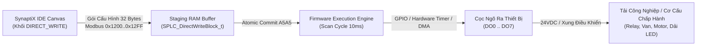

# TÀI LIỆU ĐẶC TẢ GIAO DIỆN PHẦN CỨNG & PHẦN SỤN (ICD)
## SPLC-SPEC-DIR-003: KHỐI XUẤT LỆNH CHẤP HÀNH TRỰC TIẾP CỌC NGÕ RA (DIRECT_WRITE)

**Mã tài liệu:** `SPLC-SPEC-DIR-003`  
**Phiên bản:** `v2.0.0` (Cập nhật chuẩn hóa DO0..DO7 theo kiến trúc SimplePLC V2.0)  
**Ngày phát hành:** `2026-10-19`  
**Trạng thái:** `APPROVED / AUTHORITATIVE SPECIFICATION`  
**Phạm vi áp dụng:** Firmware vi điều khiển SimplePLC / SynaptiX (STM32H5/G4/F4, ESP32-S3, RP2040, GD32), SynaptiX IDE Studio, Bo mạch Remote I/O RIO-884, Smart PLC Controller.

---

### 1. Tổng Quan Kiến Trúc (Architecture Overview)

Khối chức năng **`DIRECT_WRITE` (Huy hiệu Canvas: `DIR_WR`)** cho phép bộ điều khiển xuất dữ liệu hoặc lệnh chấp hành trực tiếp tới **một cọc ngõ ra số vật lý duy nhất (`DO0..DO7`)** của thiết bị mà **không cần thông qua giao thức truyền thông mạng Modbus RTU Slave ID**:

1. **Chuẩn hóa danh mục cọc theo thiết bị (`DO0..DO7`):**
   - Không sử dụng các định danh tùy biến hoặc không đồng nhất (như `OUT1..4` hay `FAST_IO`).
   - Mọi chân ngõ ra số trong hệ thống SimplePLC đều tuân thủ định danh duy nhất là **`DO`** (`DO0`, `DO1`, `DO2`, `DO3`, `DO4`, `DO5`, `DO6`, `DO7`...), đồng bộ 100% với Bảng Tag Catalog, Bàn I/O ảo và Bảng quy tắc logic (Rule Table).
2. **Các chế độ vận hành hỗ trợ:**
   - **Mode 0: Digital Output (`DO`):** Đóng/ngắt trực tiếp mức logic 0/1 (Relay, Van điện từ Solenoid, Đèn báo trạng thái), hỗ trợ cấu hình cực tính `Active High / Active Low` và trạng thái an toàn `Fail-Safe (0 - OFF / 1 - ON)`.
   - **Mode 1: PWM Duty Cycle (`PWM`):** Điều chế độ rộng xung công suất $0 \dots 100\%$ điều khiển độ sáng LED dimmer, van tỉ lệ khí nén/thủy lực, hoặc bộ điều tốc động cơ DC.
   - **Mode 2: Pulse Train Output (`PTO`):** Phát chuỗi xung định lượng độ chính xác cao điều khiển bộ điều khiển động cơ bước (Stepper Driver Step/Dir) hoặc phát xung đo lường.
   - **Mode 3: Addressable Actuator Bus (`BUS`):** Giao tiếp nối tiếp 1 dây điều khiển dải LED địa chỉ hóa (UCS16703, WS2812B) hoặc cụm van số thông minh qua DMA cao tốc 800 kHz.



---

### 2. Bản Đồ Bộ Nhớ Thanh Ghi Modbus (Memory Map)

Vùng nhớ cấu hình cho các khối `DIRECT_WRITE` được định vị tại dải thanh ghi **`0x1200` $\dots$ `0x12FF`** (tối đa **8 khối độc lập**, mỗi khối chiếm **16 thanh ghi Modbus = 32 bytes nhị phân**):

$$\text{Base Address} = 0\text{x}1200 + (\text{BlockIndex} \times 16) \quad (\text{BlockIndex} = 0 \dots 7)$$

#### Bảng cấu trúc chi tiết từng khối (32 Bytes / Block)

| Offset Byte | Thanh ghi | Tên trường | Kiểu dữ liệu | Diễn giải kỹ thuật & Giới hạn giá trị |
| :---: | :---: | :--- | :--- | :--- |
| `0x00` | Reg 0 (Lo) | `target_pin` | `uint8_t` | Chỉ số cọc ngõ ra số phần cứng: **`0` = DO0, `1` = DO1, $\dots$, `7` = DO7**. |
| `0x01` | Reg 0 (Hi) | `mode` | `uint8_t` | Chế độ ngõ ra: `0` = DigitalOutput, `1` = PwmDuty, `2` = PulseTrain, `3` = AddressableBus. |
| `0x02..0x03` | Reg 1 | `channel_count` | `uint16_t` (LE)| Số lượng kênh/ô địa chỉ trong chế độ Bus (1..64), hoặc số xung cơ sở. |
| `0x04` | Reg 2 (Lo) | `flags` | `uint8_t` | Bit 0: `is_active_high` (1=High, 0=Low)<br>Bit 1: `is_exclusive_channel`<br>Bit 2: `fail_safe_state` (0=OFF, 1=ON) |
| `0x05` | Reg 2 (Hi) | `trigger_mode` | `uint8_t` | `0` = OnTriggerRisingEdge (Sườn lên), `1` = Continuous (Liên tục chu kỳ quét). |
| `0x06..0x07` | Reg 3 | `pulse_width_us`| `uint16_t` (LE)| Độ rộng xung cơ sở tính bằng micro-giây ($\mu\text{s}$). Mặc định 50 $\mu\text{s}$. |
| `0x08..0x0B` | Reg 4..5 | `pwm_freq_hz` | `uint32_t` (LE)| Tần số sóng mang PWM tính bằng Hz (Ví dụ: `1000` Hz). |
| `0x0C` | Reg 6 (Lo) | `duty_min` | `uint8_t` | Giới hạn độ rộng Duty nhỏ nhất (%) (Ví dụ: `0`%). |
| `0x0D` | Reg 6 (Hi) | `duty_max` | `uint8_t` | Giới hạn độ rộng Duty lớn nhất (%) (Ví dụ: `100`%). |
| `0x0E..0x0F` | Reg 7 | `channel_tag` | `uint16_t` (LE)| TagIndex cấp giá trị đầu vào (Logic In cho DO / Duty % cho PWM / Kênh cho Bus). |
| `0x10..0x11` | Reg 8 | `param_tag` | `uint16_t` (LE)| TagIndex cấp tham số phụ (Enable En cho DO / Tần số Freq cho PTO / Mã màu RGB). |
| `0x12..0x15` | Reg 9..10 | `default_color`| `uint32_t` (LE)| Tham số mặc định 24-bit RGB (Ví dụ: `0x0000FF00` = Xanh lục). |
| `0x16..0x1F` | Reg 11..15| `reserved[10]` | `uint8_t[10]` | Vùng đệm dự phòng mở rộng (Luôn điền `0x00`). |

---

### 3. Định Nghĩa C Struct Chuẩn Cho Firmware Nhúng

Được khai báo chính thức tại header chuẩn [`src/SimplePLC.Protocol/Firmware/simpleplc_protocol_v2_0.h`](file:///g:/HoaNV/Projects/SimplePLC/src/SimplePLC.Protocol/Firmware/simpleplc_protocol_v2_0.h):

```c
#ifndef SPLC_DIRECT_WRITE_ICD_H
#define SPLC_DIRECT_WRITE_ICD_H

#include <stdint.h>
#include <stdbool.h>

#pragma pack(push, 1)

/**
 * @brief Định danh chân ngõ ra số DO trên thiết bị SimplePLC
 */
typedef enum {
    SPLC_DIR_PIN_DO0 = 0,
    SPLC_DIR_PIN_DO1 = 1,
    SPLC_DIR_PIN_DO2 = 2,
    SPLC_DIR_PIN_DO3 = 3,
    SPLC_DIR_PIN_DO4 = 4,
    SPLC_DIR_PIN_DO5 = 5,
    SPLC_DIR_PIN_DO6 = 6,
    SPLC_DIR_PIN_DO7 = 7
} SPLC_DirectPin_t;

/**
 * @brief Chế độ điều khiển cọc ngõ ra
 */
typedef enum {
    SPLC_DIR_MODE_DIGITAL_OUTPUT  = 0, /* Xuất mức logic 0/1 (Relay / Van Solenoid / Đèn báo) */
    SPLC_DIR_MODE_PWM_DUTY        = 1, /* Điều chế độ rộng xung 0..100% (Dimmer / Motor Speed) */
    SPLC_DIR_MODE_PULSE_TRAIN     = 2, /* Phát chuỗi xung bước (PTO cho Stepper / Servo) */
    SPLC_DIR_MODE_ADDRESSABLE_BUS = 3  /* Bus nối tiếp 1 dây (WS2812B / UCS16703 LED strip) */
} SPLC_DirectMode_t;

/**
 * @brief Cơ chế kích hoạt xuất tín hiệu
 */
typedef enum {
    SPLC_DIR_TRIG_RISING_EDGE = 0,     /* Kích hoạt theo sườn lên của chân Trig */
    SPLC_DIR_TRIG_CONTINUOUS  = 1      /* Cập nhật liên tục theo từng chu kỳ quét scan pass */
} SPLC_DirectTrigger_t;

/**
 * @brief Cấu trúc dữ liệu nhị phân 32-byte của khối DIRECT_WRITE
 */
typedef struct {
    uint8_t  target_pin;        /* SPLC_DirectPin_t: DO0..DO7 (0..7) */
    uint8_t  mode;              /* SPLC_DirectMode_t: 0=DO, 1=PWM, 2=PTO, 3=Bus */
    uint16_t channel_count;     /* Số kênh (Bus mode) hoặc số xung định lượng */
    uint8_t  flags;             /* Bit 0: is_active_high, Bit 1: is_exclusive, Bit 2: fail_safe */
    uint8_t  trigger_mode;      /* SPLC_DirectTrigger_t: 0=RisingEdge, 1=Continuous */
    uint16_t pulse_width_us;    /* Độ rộng xung tính bằng micro-giây (µs) */
    uint32_t pwm_freq_hz;       /* Tần số sóng mang PWM (Hz) */
    uint8_t  duty_min;          /* Giới hạn Duty nhỏ nhất % (0..100) */
    uint8_t  duty_max;          /* Giới hạn Duty lớn nhất % (0..100) */
    uint16_t channel_tag_index; /* Tag Index cung cấp giá trị logic In / Duty % / Kênh */
    uint16_t param_tag_index;   /* Tag Index cung cấp giá trị Enable En / Tần số / Màu RGB */
    uint32_t default_color_rgb; /* Tham số màu sắc mặc định 24-bit RGB (0x00RRGGBB) */
    uint8_t  reserved[10];      /* Đệm căn chỉnh đúng 32 bytes */
} SPLC_DirectWriteBlock_t;

#pragma pack(pop)

#endif // SPLC_DIRECT_WRITE_ICD_H
```

---

### 4. Thuật Toán Thực Thi Chi Tiết Trên Firmware MCU

#### 4.1. Chế độ 0: Digital Output (`DO`)
1. **Kiểm tra cờ cho phép (Enable):** Nếu `param_tag_index` hợp lệ, đọc giá trị Tag tương ứng. Nếu giá trị $= 0$, tắt ngõ ra cọc (về trạng thái nghỉ an toàn).
2. **Đọc mức logic yêu cầu:** Đọc giá trị từ `channel_tag_index`. Mức $1$ là yêu cầu kích hoạt, $0$ là yêu cầu ngắt.
3. **Áp dụng cực tính (`is_active_high`):**
   - Nếu `is_active_high == true`: Mức 1 xuất điện áp $24\text{ VDC}$ (BẬT), Mức 0 ngắt điện áp $0\text{ VDC}$ (TẮT).
   - Nếu `is_active_high == false` (Active Low): Mức 0 xuất $24\text{ VDC}$, Mức 1 ngắt $0\text{ VDC}$.
4. **Xử lý Fail-Safe:** Khi hệ thống khởi động hoặc xảy ra mất kết nối / Watchdog timeout, cọc tự động duy trì giá trị `fail_safe_state` (0 = Ngắt tải hoàn toàn, 1 = Duy trì cấp tải).

#### 4.2. Chế độ 1: PWM Duty Cycle (`PWM`)
1. **Đọc giá trị Duty:** Đọc giá trị phần trăm từ `channel_tag_index` ($0 \dots 100\%$).
2. **Kẹp biên an toàn (Duty Clamping):**
   $$\text{Duty}_{\text{clamped}} = \max(\text{duty\_min}, \min(\text{Duty}_{\text{read}}, \text{duty\_max}))$$
3. **Cập nhật phần cứng Timer:** Cập nhật thanh ghi Compare/Capture Register (CCR) của Hardware Timer mà không làm gián đoạn chu kỳ sóng mang:
   $$\text{CCR} = \frac{\text{Duty}_{\text{clamped}}}{100.0} \times \text{ARR}$$

#### 4.3. Chế độ 2: Pulse Train Output (`PTO`)
1. **Phát hiện sườn lên:** Đọc chân `Trig`. Khi phát hiện chuyển mức $0 \rightarrow 1$:
2. **Tính toán số xung & tần số:** Đọc số xung cần phát từ `channel_tag_index` và tần số phát từ `param_tag_index`.
3. **Kích hoạt DMA/Timer:** Cấu hình Hardware Timer chạy ở chế độ One-Pulse hoặc nạp số chu kỳ xung vào bộ đếm lặp lặp (RCR/DMA).
4. **Báo hoàn tất (`Done`):** Khi phát hết số xung chỉ định, ngắt Hardware Timer phát cờ `Done` trong đúng 1 chu kỳ quét logic.

#### 4.4. Chế độ 3: Addressable Actuator Bus (`BUS` / UCS16703, WS2812B)
1. **Xử lý độc quyền kênh (`is_exclusive_channel == true`):** Tự động xóa bộ đệm hiển thị của $N$ kênh (`channel_count`) về màu đen (`0x000000`).
2. **Ánh xạ kênh & màu:** Đọc mã kênh từ `channel_tag_index` ($1 \dots N$) và mã màu RGB từ `param_tag_index` (hoặc dùng `default_color_rgb`).
3. **Truyền dữ liệu bằng DMA:** Khởi động DMA xuất luồng bit 800 kHz ra cọc vật lý mà **không làm chậm hoặc khóa vòng quét PLC 10ms**.

---

### 5. Mã Nguồn Mẫu Tích Hợp Trên Firmware MCU

#### Ví dụ triển khai trên STM32 HAL (Timer PWM & GPIO)

```c
#include "simpleplc_protocol_v2_0.h"
#include "main.h"

// Bảng ánh xạ cọc DO0..DO7 sang GPIO Pin & Timer Channel phần cứng
typedef struct {
    GPIO_TypeDef* port;
    uint16_t      pin;
    TIM_HandleTypeDef* htim;
    uint32_t      tim_channel;
} splc_mcu_do_mapping_t;

static const splc_mcu_do_mapping_t g_do_pins[8] = {
    { DO0_GPIO_Port, DO0_Pin, &htim1, TIM_CHANNEL_1 },
    { DO1_GPIO_Port, DO1_Pin, &htim1, TIM_CHANNEL_2 },
    { DO2_GPIO_Port, DO2_Pin, &htim2, TIM_CHANNEL_1 },
    { DO3_GPIO_Port, DO3_Pin, &htim2, TIM_CHANNEL_2 },
    { DO4_GPIO_Port, DO4_Pin, NULL,   0             },
    { DO5_GPIO_Port, DO5_Pin, NULL,   0             },
    { DO6_GPIO_Port, DO6_Pin, NULL,   0             },
    { DO7_GPIO_Port, DO7_Pin, NULL,   0             }
};

void splc_direct_write_execute(const SPLC_DirectWriteBlock_t* cfg, uint32_t in_val, uint32_t param_val) {
    if (cfg->target_pin >= 8) return;
    const splc_mcu_do_mapping_t* hw = &g_do_pins[cfg->target_pin];

    switch (cfg->mode) {
        case SPLC_DIR_MODE_DIGITAL_OUTPUT: {
            bool active_high = (cfg->flags & 0x01) != 0;
            bool state = (in_val != 0);
            GPIO_PinState pin_state = (state == active_high) ? GPIO_PIN_SET : GPIO_PIN_RESET;
            HAL_GPIO_WritePin(hw->port, hw->pin, pin_state);
            break;
        }

        case SPLC_DIR_MODE_PWM_DUTY: {
            if (hw->htim == NULL) return;
            uint32_t duty = in_val;
            if (duty < cfg->duty_min) duty = cfg->duty_min;
            if (duty > cfg->duty_max) duty = cfg->duty_max;
            
            uint32_t arr = __HAL_TIM_GET_AUTORELOAD(hw->htim);
            uint32_t ccr = (arr * duty) / 100;
            __HAL_TIM_SET_COMPARE(hw->htim, hw->tim_channel, ccr);
            break;
        }

        case SPLC_DIR_MODE_ADDRESSABLE_BUS: {
            // Kích hoạt SPI / DMA xuất 800kHz cho UCS16703 / WS2812B
            splc_led_bus_dispatch(cfg->target_pin, in_val, param_val, cfg->flags & 0x02);
            break;
        }

        default:
            break;
    }
}
```

---

### 6. Bảng Tiêu Chí Nghiệm Thu Phần Sụn (Firmware Conformance Checklist)

- [x] **Ánh xạ cọc DO0..DO7:** Firmware nhận diện chính xác các giá trị `target_pin` từ 0 đến 7 tương ứng với các cọc `DO0` đến `DO7` trên vỏ thiết bị.
- [x] **Thời gian đáp ứng:** Độ trễ từ khi logic cập nhật đến khi cọc phần cứng đổi trạng thái nhỏ hơn một chu kỳ quét ($\le 10\text{ ms}$).
- [x] **An toàn Fail-Safe:** Khi kích hoạt lệnh khẩn cấp hoặc mất kết nối Studio, ngõ ra tự động trở về mức an toàn được chỉ định trong `fail_safe_state`.
- [x] **Không nghẽn chu kỳ quét:** Việc phát xung PWM cao tốc hoặc truyền chuỗi dữ liệu 800 kHz qua DMA không làm kéo dài thời gian quét danh định 10ms của bộ điều khiển.
